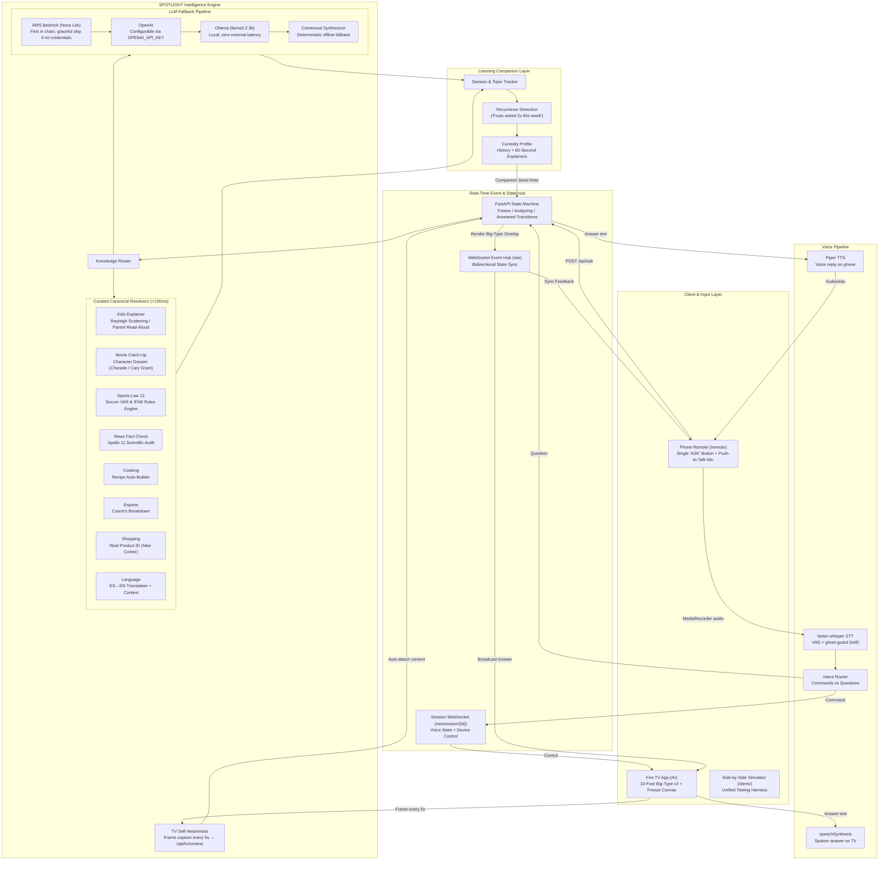

# SPOTLIGHT Architecture: The Living Room Curiosity Engine

> SPOTLIGHT transforms passive television viewing into an interactive, low-friction knowledge layer.
> This document describes the shipped architecture: scene understanding, knowledge engines, voice pipeline,
> and the learning companion layer.

---

## 1. System Architecture Overview



---

## 2. Core Pillars

### Pillar 1: TV Self-Awareness (Scene Context)
When the viewer hits **ASK**, SPOTLIGHT binds the question to the current TV context:

1. **Frame Capture:** The `/tv` page captures a frame from the `<video>` element via canvas every 5 seconds, scales to max 640px, and POSTs it (as JPEG base64) along with title, current timecode, and paused state to `POST /api/tv/context`.
2. **Context Store:** The backend keeps the latest context per session in an in-memory `TVContextStore`.
3. **Auto-Attach:** When `/api/ask` receives a request with no explicit `context_title` or `frame_b64`, the backend auto-attaches the latest stored TV context. Explicit context always wins over auto-attached context.

This means the viewer does not need to manually specify what they are watching — the system already knows.

### Pillar 2: The Dual-Tier Knowledge Engine
Speed and reliability are paramount for television: viewers will abandon an overlay if it buffers or hallucinates. SPOTLIGHT uses a hybrid resolution pipeline:

1. **Curated Canonical Resolvers (<100ms):**
   - 8 knowledge engines (one per beat): kids, movie, sports, news, cooking, esports, shopping, language.
   - Each has a `can_handle_canonical()` matcher that checks the question against canonical keywords.
   - On a match, returns a deterministic, pre-written answer with structured JSON (title, subtitle, verdict badge, explanation, key details, sources).
   - The first 4 beats (kids, movie, sports, news) have canonical answers translated into EN/ES/HI; the remaining 4 fall back to English.

2. **LLM Fallback Pipeline (in priority order):**
   - **AWS Bedrock** (Nova Lite): First in the chain. Uses the standard boto3 credential chain. Gracefully skips if no credentials are available — logs and continues.
   - **OpenAI**: Activates when `OPENAI_API_KEY` is set. Configurable model via `OPENAI_MODEL` (default: `gpt-4o-mini`).
   - **Ollama** (`llama3.2:3b`): Local LLM at `http://localhost:11434`. Zero cost, zero keys. Also handles vision queries with `llava`.
   - **Contextual Synthesizer**: Deterministic, zero-crash fallback. Constructs a context-aware answer using scene metadata when all LLMs are unreachable.

   All LLM responses are parsed into a strict JSON schema:
   ```json
   {
     "title": "Headline",
     "subtitle": "Category Badge",
     "verdict_badge": "Status Tag",
     "verdict_color": "sky|amber|rose|emerald|purple",
     "primary_explanation": "2-3 authoritative sentences",
     "key_details": ["Detail 1", "Detail 2"],
     "sources": ["Source 1", "Source 2"]
   }
   ```

3. **Vision Path:** When a frame is attached (either from camera snap or auto-attached TV context), the router routes to vision analysis. `spotlight/vision.py` runs frame analysis (Ollama llava, Bedrock vision, or PIL heuristic fallback) and passes the result through the same LLM fallback chain to generate a structured answer.

### Pillar 3: Voice Pipeline
Voice interaction is push-to-talk on the phone remote:

1. **Recording:** The `/remote` page uses `MediaRecorder` to capture audio (webm/opus). The Web Speech API provides live partial transcript previews via `SpeechRecognition` when available.
2. **Transcription:** Audio is sent as base64 to `POST /api/voice/transcribe`, which runs `faster-whisper` (int8, VAD filter, word timestamps). Ghost-guard drops segments with high `no_speech_prob` to prevent silence hallucinations.
3. **Intent Routing:** Transcribed text goes through `classify_intent()` — commands (pause, play, rewind, forward, volume up/down, mute, go-back) are routed via the session WebSocket hub to the TV; questions continue to the `/api/ask` pipeline.
4. **Voice Reply:** The answer is spoken two ways:
   - **Phone:** `POST /api/voice/speak` runs Piper TTS (subprocess, `en_US-lessac-medium` voice) and returns audio/wav. The phone plays it via `<audio>`.
   - **TV:** The `/tv` page uses the browser's `speechSynthesis` API to speak the answer aloud (title + primary explanation).

### Pillar 4: The Learning Companion Layer
The single tap is the entry point; the **Curiosity Profile** is the long-term retention moat:
- **Topic Recurrence Tracking:** Each question is classified into a topic (fouls, sky, characters, fact_checks, recipes, esports, shopping, language). After 2+ asks in a topic, the system suggests a 60-second explainer (`GET /api/companion/summary`).
- **60-Second Explainers:** Pre-written explainers for each topic, accessible via `GET /api/companion/explainer/{topic}`.
- **Companion Notes:** Every answer includes a companion note (e.g., "You've asked about fouls twice this week. Added Law 12 to your Sports Companion").
- **Session History:** All questions and answers are logged per session with engine type (canonical vs LLM), latency, and companion notes (`GET /api/history`).

---

## 3. The 10-Foot TV UI System

Fire TV interfaces must be readable from across a room (the 10-foot UI guideline):
- **High Visual Contrast:** Carbon black backgrounds (`#08090c`) with vibrant accent colors (Emerald for fact checks, Amber for cinema, Rose for referee decisions, Sky for kids science, Purple for esports).
- **Legible Typography Hierarchy:**
  - 36px–42px primary titles
  - 24px–26px primary answer explanations
  - 16px structured key detail cards
- **Technical Badges:** Status pills and verdict badges instead of emoji, preserving a cinematic atmosphere.
- **Freeze Feedback:** Visual vignette pulse and desaturation indicate an instant freeze, eliminating user uncertainty during processing.

---

## 4. API Surface

| Endpoint | Method | Purpose |
| :--- | :--- | :--- |
| `/api/ask` | POST | Core ask flow: freeze, resolve, log, answer |
| `/api/state` | GET | Current TV state and scene |
| `/api/scenes` | GET | List all 8 beats and their scene data |
| `/api/beat` | POST | Switch active beat |
| `/api/dismiss` | POST | Dismiss overlay, resume playback |
| `/api/reset` | POST | Reset state machine and session history |
| `/api/history` | GET | Session history and companion stats |
| `/api/history/clear` | POST | Clear session history |
| `/api/companion/summary` | GET | Topic counts + suggested explainer |
| `/api/companion/explainer/{topic}` | GET | 60-second explainer for a topic |
| `/api/analyze-frame` | POST | Frame analysis (base64 image → scene understanding) |
| `/api/tv/context` | POST | TV self-awareness: store frame + metadata per session |
| `/api/tv/context/{session_id}` | GET | Retrieve stored TV context |
| `/api/voice/transcribe` | POST | faster-whisper STT + intent classification |
| `/api/voice/speak` | POST | Piper TTS synthesis → audio/wav |
| `/api/demo/script` | GET | Deterministic 4-beat demo script |
| `/api/demo/step` | POST | Execute a demo step without network dependency |
| `/ws` | WS | Bidirectional state sync (TV ↔ remote) |
| `/ws/session/{session_id}` | WS | Session hub: voice state + device control |
| `/health` | GET | Debug metrics JSON (behind `SPOTLIGHT_DEBUG=1`): uptime, per-session context, STT/ask timings, LLM provider, cache stats |

---

## 5. Technology Stack

| Layer | Technology |
| :--- | :--- |
| Backend | FastAPI, uvicorn, Pydantic |
| Frontend | Vanilla JS, Jinja2 templates, CSS |
| STT | faster-whisper (int8, VAD, ghost-guard) |
| TTS (phone) | Piper TTS (subprocess, en_US-lessac-medium) |
| TTS (TV) | Browser speechSynthesis API |
| LLM Fallback | AWS Bedrock (Nova Lite) → OpenAI → Ollama (llama3.2:3b) → contextual synthesis |
| Vision | Ollama llava / Bedrock vision / PIL heuristic |
| State Sync | WebSockets (state hub + session hub) |
| Testing | pytest, pytest-asyncio (87 tests) |

---

## 6. Production Hardening

- **Pairing.** Sessions are random per-load codes (`SPOT-4821`) shown on the TV; the phone pairs once. `?session=` overrides for development.
- **Rate limiting.** In-memory token buckets: `/api/tv/context` 1 req/2s per session, `/api/voice/transcribe` 20 req/min per IP; payload caps (frame ~2MB, audio 10MB) return 413.
- **Spoiler-aware prompts.** `current_time` threads from `/api/ask` → router → LLM fallback; when known, the system prompt carries a SPOILER RULE limiting answers to content up to the viewer's timestamp.
- **Answer cache.** In-memory `(title, 30s bucket, question)` → `AnswerPayload`, 1h TTL, 500-entry cap; hits recorded in metrics.
- **Voice-state mirroring.** `setVoiceState` on the TV publishes `{kind: "tv_voice_state"}` to the session hub; the phone renders it and shows `RECONNECTING` on socket drop.
- **Privacy.** Frames are memory-only per session, overwritten ~every 5s, never persisted; see PRIVACY.md.

---

## 7. What Is Not Shipped (Honest Gaps)

These are design directions mentioned in early planning, not implemented in the shipped app:

- **Broadcast transport stream integration:** The TV context comes from DOM/canvas frame capture, not from a broadcast transport stream or closed-captioning clock sync.
- **Broadcaster data feeds (Sky Sports, ESPN, Discovery):** Not integrated. Sports and news answers use curated canonical data and LLM-generated responses.
- **Prime Video X-Ray integration:** Not integrated. Movie catch-up uses the curated Charade (1963) engine and LLM fallback.
- **Persistent cross-session profiles:** The learning companion is in-memory per session. Data resets on server restart.
- **Alexa Skill:** A stub interaction model exists in `alexa/`, but the skill is not deployed or shipped. See `alexa/ALEXA_SKILL.md`.
