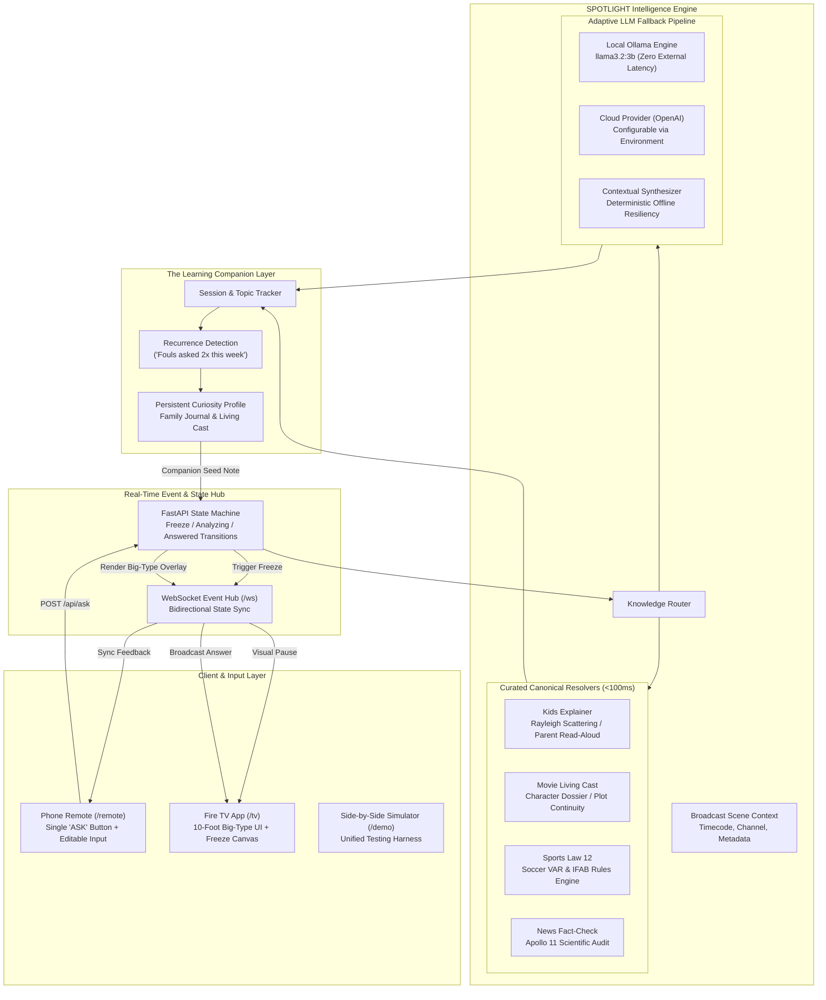

# SPOTLIGHT Architecture: The Living Room Curiosity Engine

> *"Demo the feature, sell the engine."*  
> SPOTLIGHT transforms passive television viewing into an interactive, low-friction knowledge layer. This document describes the underlying architecture: Scene Understanding, Knowledge Graph, and the Learning Companion Layer.

---

## 1. System Architecture Overview



---

## 2. Core Pillars of the Engine

### Pillar 1: Real-Time Scene Understanding
When the viewer hits **ASK**, SPOTLIGHT binds three data streams into a single query vector:
1. **Temporal Position (Timecode):** Identifies the exact second of broadcast (e.g. `74:12` in a football match, `01:12:45` in a thriller).
2. **Channel & Content Metadata:** Program identifier, genre classification, and structural broadcast segment.
3. **Active Narrative State:** Current plot state, active characters on screen, recent penalty events, or broadcast claims.

In production on Fire OS, this connects directly into the broadcast transport stream and closed-captioning / subtitle clock sync, allowing exact frame anchoring without manual input.

### Pillar 2: The Dual-Tier Knowledge Engine
Speed and reliability are paramount for television: viewers will abandon an overlay if it buffers for 10 seconds or hallucinates during a live demo. SPOTLIGHT uses a hybrid resolution pipeline:

1. **Curated Canonical Resolvers (<100ms):**
   - High-confidence matchers for common television inquiries (rules, plot catch-ups, fact checks).
   - Guarantees 100% deterministic demo execution and instant feedback.
2. **Local & Cloud LLM Fallback Pipeline:**
   - Default: Local **Ollama** running `llama3.2:3b` directly on local edge hardware or home server.
   - Cloud: Swappable OpenAI provider via `OPENAI_API_KEY` for advanced reasoning.
   - Structured JSON Output: Enforces a strict schema:
     ```json
     {
       "title": "Headline",
       "subtitle": "Category Badge",
       "verdict_badge": "Status Tag",
       "verdict_color": "sky|amber|rose|emerald|purple",
       "primary_explanation": "2-3 authoritative sentences",
       "key_details": ["Detail 1", "Detail 2"],
       "sources": ["Source 1", "Source 2"]
     }
     ```
   - Resilient Fallback: If both Ollama and cloud APIs are unreachable, a deterministic contextual synthesizer constructs an authoritative answer using scene metadata.

### Pillar 3: The Learning Companion Layer ("Sell the Engine")
The single tap is the entry point; the **Curiosity Profile** is the long-term retention moat:
- **Topic Recurrence Analysis:** Detects recurring curiosity patterns across sessions (e.g., *"You've asked about fouls twice this week. Added Law 12 to your Sports Companion"*).
- **Domain-Specific Longitudinal Knowledge:**
  - *Sports:* Builds personal referee cheat sheets (offsides, fouls, VAR triggers).
  - *Cinema:* Populates a *Living Cast* dossier, notifying viewers when a previously queried character re-enters the narrative.
  - *Kids & Education:* Exports bedtime reading topics into a *Family Curiosity Journal*.
  - *News & Documentaries:* Generates a citation-backed *Trust Feed* for reviewed claims.

---

## 3. The 10-Foot TV UI System

Fire TV interfaces must be readable from across a room (the 10-foot UI guideline):
- **High Visual Contrast:** Rich carbon black backgrounds (`#08090c`) with vibrant accents (Emerald for fact checks, Amber for cinema, Rose for referee decisions, Sky for kids science).
- **Legible Typography Hierarchy:**
  - 36px–42px primary titles
  - 24px–26px primary answer explanations
  - 16px structured key detail cards
- **Zero Emoji Principle:** Replaced with crisp technical badges, status pills, and geometric live indicators to preserve a cinematic, high-production atmosphere.
- **Micro-Freeze Feedback:** Visual vignette pulse and desaturation indicate an instant freeze, eliminating user uncertainty during processing.

---

## 4. Hardware & Ecosystem Integration

SPOTLIGHT is architected to slot natively into the Amazon Fire TV ecosystem:
- **Fire TV Remote Integration:** The mobile Ask button can map directly to a custom button on the Alexa Voice Remote Pro or an Alexa voice intent (*"Alexa, spotlight this moment"*).
- **Prime Video X-Ray Synergy:** While X-Ray provides actor filmographies, SPOTLIGHT provides contextual *narrative intelligence* (explaining *why* characters are acting, or *why* a call was made).
- **Broadcaster & Sports Rights Integration:** Broadcasters (Sky Sports, ESPN, Discovery) can supply verified data feeds into SPOTLIGHT's knowledge graph to deliver sanctioned real-time officiating interpretations.
